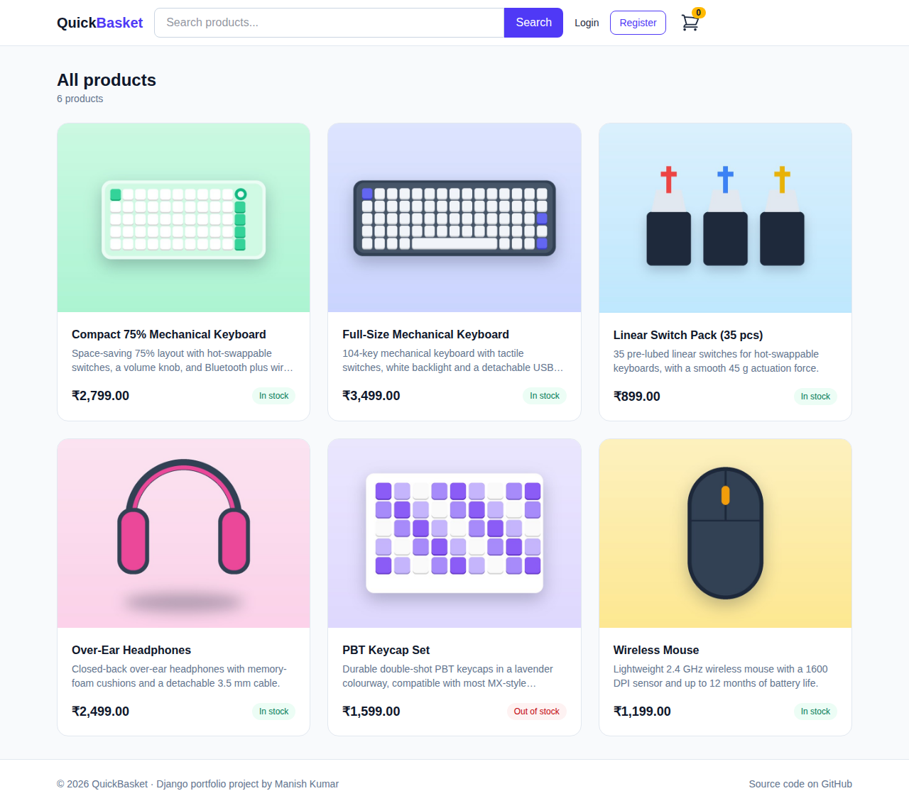
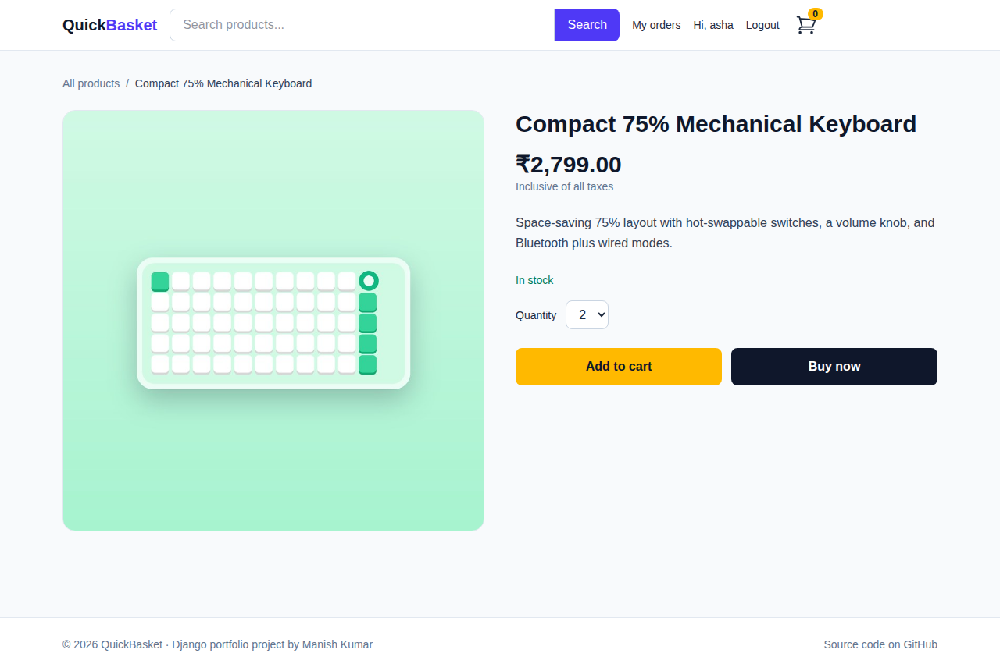
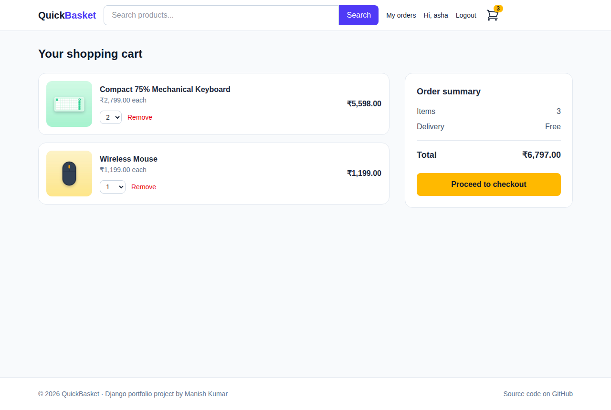
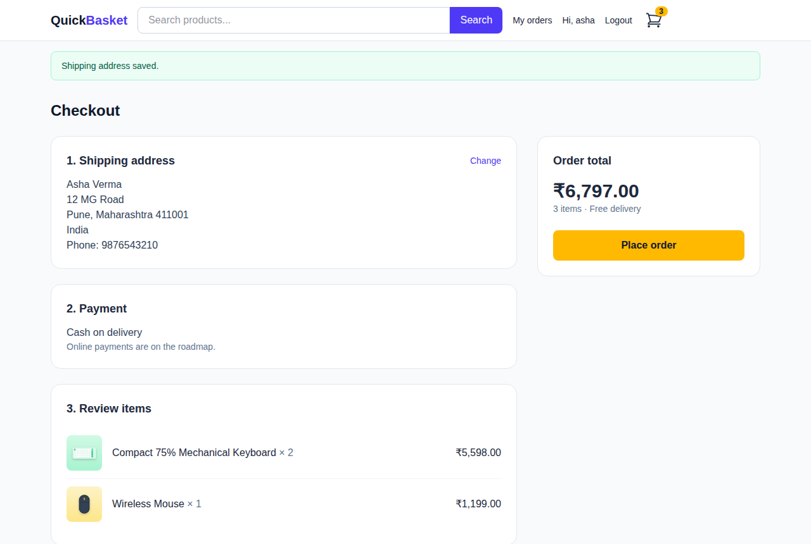
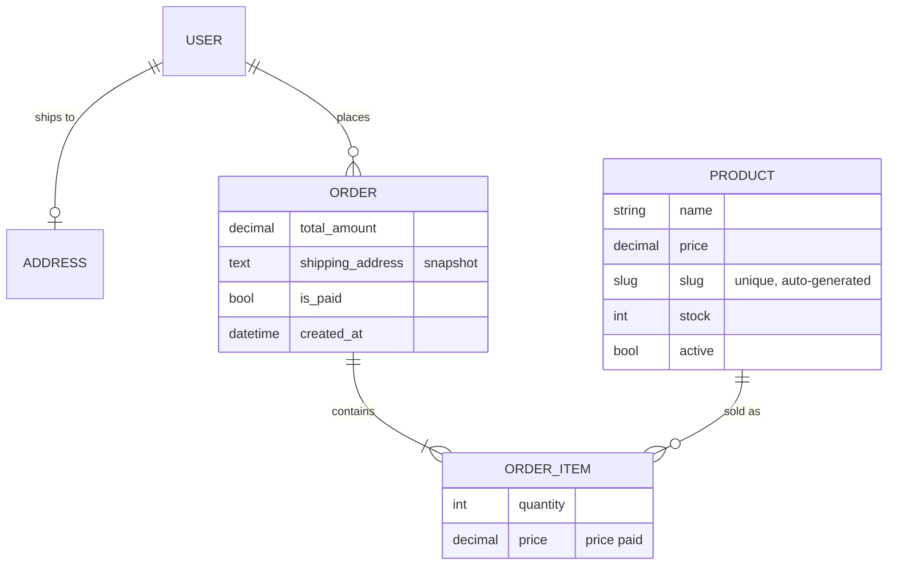
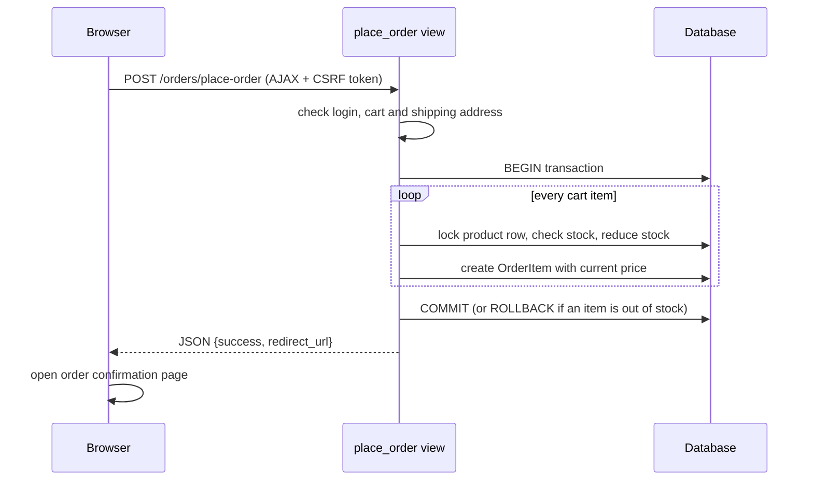

# QuickBasket – E-commerce Web App (Python · Django)

[](https://github.com/Manish12858/quickbasket/actions/workflows/ci.yml)


QuickBasket is a full-stack e-commerce web application built with **Python and Django**.
Customers can search and browse products, manage a cart without page reloads, sign up with
**email verification**, save a shipping address and place orders that update stock in real time.
Store owners manage products and orders in the Django admin.

The project is covered by **pytest unit tests** and a **Playwright end-to-end test**, which run
on every push with **GitHub Actions**.

## Screenshots

| Home | Product |
|------|---------|
|  |  |
| **Cart** | **Checkout** |
|  |  |

*Screenshots are captured automatically by the Playwright end-to-end test in CI.*

---

## Features

**Shopping**
- Product catalogue with **search** (name and description) and SEO-friendly URLs such as
  `/wireless-mouse`; slugs are generated automatically and kept unique.
- **Session-based cart** that works for guests and survives login. Add, update and remove items
  with **AJAX (jQuery)**; the cart badge updates without a page reload.
- **Buy now** button, stock status and an "only 3 left" hint; quantities are limited by available stock.

**Orders**
- Checkout with a saved shipping address, order review and cash-on-delivery payment.
- Placing an order runs in a **database transaction**: stock is locked and reduced for every item,
  and the whole order is rolled back if any item has run out.
- Each order stores the price paid and a snapshot of the shipping address.
- **My orders** history and order detail pages (users can only see their own orders).

**Accounts**
- Registration with **email verification**: accounts stay inactive until the user opens a signed
  link (custom `PasswordResetTokenGenerator`; the link stops working once it has been used).
- Login with safe `?next=` redirects, logout, profile update, and a full **password-reset** flow.

**Admin**
- Edit price, stock and visibility straight from the product list; orders show their items inline.

**Quality**
- 44 pytest tests + 1 Playwright browser test, run in CI along with a missing-migrations check.
- Secrets are read from environment variables; nothing sensitive is committed.

---

## Tech stack

| Layer      | Technology |
|------------|------------|
| Backend    | Python 3.12, Django 6.0 (ORM, sessions, auth, transactions, admin) |
| Frontend   | Django templates, Tailwind CSS, jQuery (AJAX) |
| Database   | SQLite (development) |
| Testing    | pytest, pytest-django, Playwright (end-to-end) |
| CI         | GitHub Actions |
| Other      | Pillow (images), python-dotenv (configuration), Gmail SMTP or console email |

---

## How it works

### Data model



### Placing an order



---

## Project structure

```
quickbasket/
├── manage.py
├── requirements.txt / requirements-dev.txt
├── .env.example              # template for environment variables
├── quickbasket/              # project settings and root URLs
├── products/                 # Product model, list/search and detail views, sample data
├── cart/                     # session Cart class, AJAX endpoints, context processor
├── orders/                   # Address, Order, OrderItem; checkout, place order, order history
├── users/                    # register, email verification, login, profile, password reset
├── templates/                # base layout and shared partials
├── media/samples/            # sample product images
├── tests/                    # pytest tests (+ tests/e2e for Playwright)
└── .github/workflows/ci.yml  # GitHub Actions pipeline
```

---

## Getting started

**Requirements:** Python 3.12+ and Git.

```bash
# 1. Clone the repository
git clone https://github.com/Manish12858/quickbasket.git
cd quickbasket

# 2. Create and activate a virtual environment
python -m venv venv
source venv/bin/activate          # Windows: venv\Scripts\activate

# 3. Install dependencies
pip install -r requirements.txt

# 4. Set up the database and load the sample products
python manage.py migrate
python manage.py loaddata sample_products

# 5. Create an admin user and start the server
python manage.py createsuperuser
python manage.py runserver
```

Open **http://127.0.0.1:8000** for the store and **http://127.0.0.1:8000/admin** for the admin panel.

> **No email setup needed:** without Gmail credentials, verification and password-reset emails are
> printed in the terminal running `runserver`. Copy the link from there to activate your account.

### Environment variables

Optional. Copy `.env.example` to `.env` and change what you need.

| Variable | Purpose | Default |
|----------|---------|---------|
| `DJANGO_SECRET_KEY` | Django secret key | development-only key |
| `DJANGO_DEBUG` | Debug mode | `True` |
| `DJANGO_ALLOWED_HOSTS` | Comma-separated allowed hosts | `localhost,127.0.0.1` |
| `DJANGO_SERVE_MEDIA` | Serve product images through Django | `True` |
| `EMAIL_HOST_USER` | Gmail address used to send emails | empty → emails printed in terminal |
| `EMAIL_HOST_PASSWORD` | Gmail **app password** | empty → emails printed in terminal |

---

## Running the tests

```bash
pip install -r requirements-dev.txt
python -m playwright install chromium     # only needed for the browser test

pytest                 # all tests
pytest -m "not e2e"    # unit tests only
pytest -m e2e --headed # watch the end-to-end test in a browser
```

What is tested:

| Area | Examples |
|------|----------|
| Products | unique slugs, search, inactive products hidden, 404 for unknown products |
| Cart | add / update / remove, stock limits, invalid input, cart kept after login |
| Orders | login and address required, stock reduced, **rollback when stock runs out**, users can't see others' orders |
| Accounts | email verification (link works once), unique email, safe `next` redirects, password reset |
| End-to-end | register → verify email → log in → add to cart → checkout → order confirmation |

---

## Main URLs

| URL | Description |
|-----|-------------|
| `/` and `/?q=mouse` | Product list and search |
| `/<slug>` | Product detail |
| `/cart/cart-overview` | Shopping cart |
| `/cart/add`, `/cart/update`, `/cart/delete` | AJAX cart endpoints (POST) |
| `/orders/checkout/` | Checkout |
| `/orders/my-orders` | Order history |
| `/users/register`, `/users/login`, `/users/profile` | Account pages |
| `/admin/` | Django admin |

---

## Roadmap

- [ ] Online payments with Razorpay (test mode)
- [ ] Product categories and filters
- [ ] Product reviews and ratings
- [ ] PostgreSQL and a public live demo

---

## Author

**Manish Kumar** – Python / Django developer

- GitHub: [@Manish12858](https://github.com/Manish12858)
- Email: manishkumarjamia@gmail.com

Sample product images are original illustrations made for this project.
